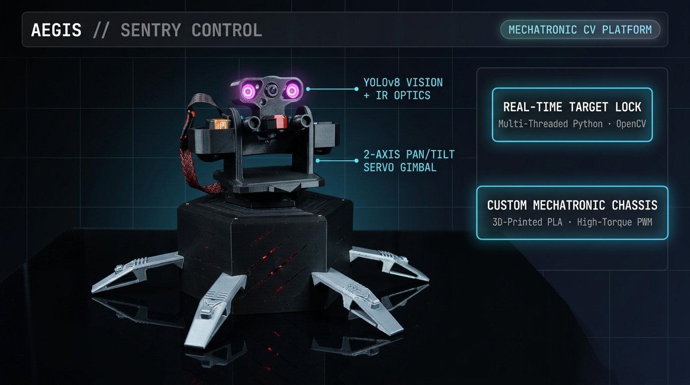

### **Executive Summary**
**Aegis Control** is a closed-loop, 2-axis autonomous mechatronic tracking platform engineered from bare-metal power distribution up to real-time computer vision inference. Built around a **Raspberry Pi 4** compute core paired with an **ESP32** telemetry node for drone integration, the system runs a quantized **YOLOv8 (TFLite)** detector to acquire aerial and ground targets and actuate high-torque `35 kg·cm` pan/tilt servos with sub-frame responsiveness.

<p style="margin: 1rem 0 1.5rem 0;">
  <a href="https://www.hackster.io/NasonNation_Robotics/aegis-control-ai-powered-sentry-turret-drone-system-a2892e" target="_blank" rel="noopener" style="display: inline-block; padding: 8px 18px; border-radius: 7px; font-weight: 700; font-size: 0.88rem; background: rgba(14, 32, 48, 0.92); color: #7dd3fc; border: 1px solid #38bdf8; text-decoration: none;">
    Read Full Hardware &amp; Build Publication on Hackster.io &rarr;
  </a>
</p>

---

### **System Specifications**

| Subsystem | Engineering Implementation |
| :--- | :--- |
| **Edge Compute &amp; Telemetry** | Raspberry Pi 4 (Vision &amp; Control Host) + ESP32 (Auxiliary Drone / Peripheral Link) |
| **Perception Payload** | Quantized Custom **YOLOv8 (TFLite)** + `Picamera2` CSI Sensor with Dual-IR Illumination |
| **Actuation &amp; Bus** | Dual `35 kg·cm` High-Torque Servos driven via **I2C &rarr; PCA9685** 16-Ch Hardware PWM |
| **Power Integrity** | Isolated multi-rail buck topology + **MOSFET** load switching (zero logic-rail brownout under stall) |
| **Chassis Mechanics** | High-rigidity hexagonal base with 4 wide-stance outriggers to counter rapid pan reaction torque |
| **Operator Interface** | Low-latency **Flask** web HUD with live MJPEG stream &amp; manual override |

---

### **Architecture &amp; Engineering Tradeoffs**

#### **1. Power Rail Isolation &amp; Mechanical Stiffness**
High-torque `35 kg·cm` servos draw aggressive transient inrush currents during rapid direction reversals, which will brown out a shared 5V SBC rail or inject switching noise into camera CSI lines.
* **Multi-Rail Power Distribution:** Engineered a split-rail power distribution network using dedicated step-down buck converters and **MOSFET-gated actuation rails**, completely isolating servo inductive load spikes from the Raspberry Pi 4 and ESP32 logic supply.
* **Hardware PWM Offload (`PCA9685`):** Because non-RTOS Linux scheduling introduces microsecond-level GPIO jitter (causing physical servo chatter at rest), pulse generation is offloaded over **I2C** to a dedicated hardware crystal-timed `PCA9685` controller.
* **Reaction-Torque Stabilization:** Rapid pan accelerations generate significant counter-torque; the hexagonal lower housing and 4 mechanical outrigger legs keep the optical axis rigid without structural flex or gear binding.

#### **2. Decoupled Perception-to-Actuation Pipeline**
Running TFLite object detection, MJPEG operator streaming, and `50 Hz` servo control Loops sequentially in a single Python process starves the gimbal controller whenever inference latency fluctuates. Aegis decouples capture, inference, and kinematic actuation across independent threads synchronized via lightweight locks:

* **Zero-Block Frame Handoff:** The `Picamera2` acquisition thread continuously updates the latest frame buffer so YOLOv8 inference never processes stale queued frames (eliminating lag-induced overshoot).
* **Proportional Tracking with Deadband &amp; Slew Clamping:** Bounding-box centroid pixel error `(err_x, err_y)` is passed through a pixel deadband filter (preventing servo hunting at lock) and a slew-clamped proportional controller (`Kp`) before writing pulse-width updates over I2C.

```python
import time
import threading

# Control constants (calibrated to optical FOV & 35kg-cm servo mechanics)
FRAME_CX, FRAME_CY = 320, 240
DEADBAND_PX = 12          # Suppress micro-oscillation / hunting when locked on target
KP_PAN, KP_TILT = 0.085, 0.075
MAX_STEP_US = 28          # Slew-rate clamp to limit mechanical jerk & current spikes
PULSE_MIN, PULSE_MAX = 600, 2400
CONTROL_HZ = 50

class GimbalTracker:
    def __init__(self, picam2, pca_driver):
        self.picam2 = picam2
        self.pca = pca_driver
        self.frame_lock = threading.Lock()
        self.target_lock = threading.Lock()
        self.latest_frame = None
        self.target_centroid = None   # (cx, cy) from YOLOv8 TFLite inference thread
        self.pan_us = 1500.0
        self.tilt_us = 1500.0

    def capture_worker(self):
        """Continuously refreshes latest CSI frame so CV inference never lags behind real time."""
        while True:
            frame = self.picam2.capture_array()
            with self.frame_lock:
                self.latest_frame = frame

    def control_loop_worker(self):
        """Deterministic 50 Hz proportional servo loop driving hardware PWM over I2C."""
        period = 1.0 / CONTROL_HZ
        while True:
            t0 = time.monotonic()
            with self.target_lock:
                centroid = self.target_centroid

            if centroid is not None:
                err_x = centroid[0] - FRAME_CX
                err_y = centroid[1] - FRAME_CY

                if abs(err_x) > DEADBAND_PX:
                    step_pan = max(-MAX_STEP_US, min(MAX_STEP_US, -err_x * KP_PAN))
                    self.pan_us = max(PULSE_MIN, min(PULSE_MAX, self.pan_us + step_pan))

                if abs(err_y) > DEADBAND_PX:
                    step_tilt = max(-MAX_STEP_US, min(MAX_STEP_US, err_y * KP_TILT))
                    self.tilt_us = max(PULSE_MIN, min(PULSE_MAX, self.tilt_us + step_tilt))

                self.pca.set_servo_pulse(channel=0, pulse_us=int(self.pan_us))
                self.pca.set_servo_pulse(channel=1, pulse_us=int(self.tilt_us))

            elapsed = time.monotonic() - t0
            if elapsed < period:
                time.sleep(period - elapsed)
```
